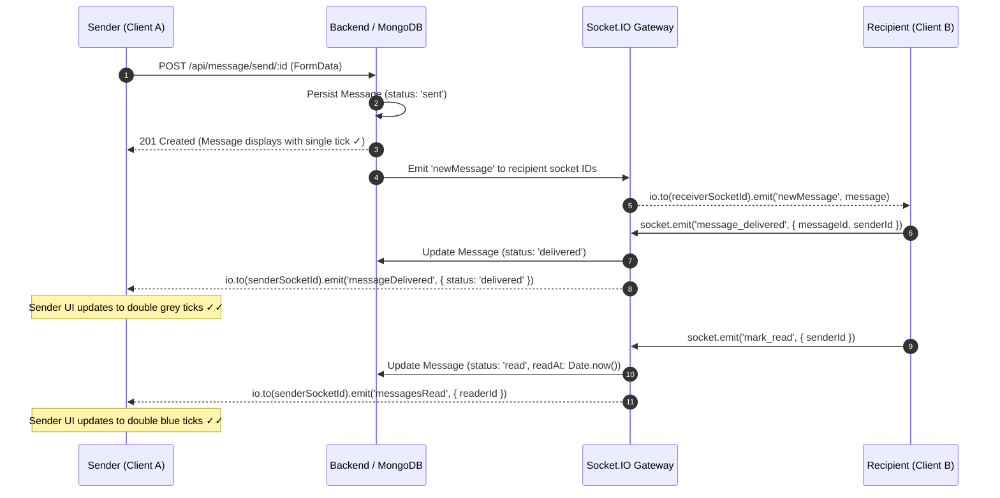

<div align="center">


<br/>

<a href="https://github.com/abhishek23027kushwaha/chat_app_live">
  
</a>

<br/><br/>

[](https://github.com/abhishek23027kushwaha/chat_app_live)
[](https://react.dev/)
[](https://nodejs.org/)
[](https://www.mongodb.com/)
[](https://socket.io/)
[](https://webrtc.org/)

<br/>


<br/><br/>

### **💬 Production-Ready Real-Time Communication & WebRTC Collaboration Suite**

</div>

<br/>

<div align="center">

### 📊 At a Glance

<table width="100%">
<tr>
<td align="center" width="20%">⚡ <b>Messaging Engine</b><br/><h3>Socket.io</h3><sub>Real-Time 1-to-1 & Groups</sub></td>
<td align="center" width="20%">🎥 <b>WebRTC Calling</b><br/><h3>P2P Mesh</h3><sub>HD Video & Audio Streams</sub></td>
<td align="center" width="20%">🎙️ <b>Voice & Speech</b><br/><h3>Audio Notes</h3><sub>Speech-to-Text (hi-IN & en)</sub></td>
<td align="center" width="20%">🖼️ <b>Media Pipeline</b><br/><h3>Cloudinary</h3><sub>5-Step Resilient Upload & CDN</sub></td>
<td align="center" width="20%">✓✓ <b>Status Tracking</b><br/><h3>Read Receipts</h3><sub>Sent · Delivered · Blue Read</sub></td>
</tr>
</table>

</div>

---

## 📖 Table of Contents

**🧭 Architecture & Concepts**

&nbsp;&nbsp;📌 [Overview](#-overview) &nbsp;·&nbsp; ✨ [Key Features](#-key-features) &nbsp;·&nbsp; 🔄 [Real-Time Workflow & Architecture](#-real-time-workflow--architecture) &nbsp;·&nbsp; 📡 [Socket.IO Event Matrix](#-socketio-event-matrix)

**🛠️ Engineering & Development**

&nbsp;&nbsp;🧰 [Tech Stack](#-tech-stack) &nbsp;·&nbsp; 📁 [Project Structure](#-project-structure) &nbsp;·&nbsp; 🚀 [Getting Started](#-getting-started) &nbsp;·&nbsp; 🔑 [Environment Variables](#-environment-variables) &nbsp;·&nbsp; 📡 [API Endpoints](#-api-endpoints)

**🛡️ Security & Delivery**

&nbsp;&nbsp;🔒 [Security & Verification](#-security--verification) &nbsp;·&nbsp; 🚢 [Production Deployment](#-production-deployment) &nbsp;·&nbsp; 🤝 [Contributing](#-contributing) &nbsp;·&nbsp; 📬 [Author & Contact](#-author--contact)

---

## 📌 Overview

**Chatly** is an enterprise-grade full-stack real-time communication platform engineered using modern **React 19**, **Vite**, **Express 5**, **MongoDB**, **Socket.IO**, and native **WebRTC**. Built with a WhatsApp-inspired design philosophy, it empowers users with ultra-responsive text messaging, group collaboration, crystal-clear browser-to-browser peer video/audio calling, voice note recording, multilingual speech-to-text, and resilient media sharing.

The platform provides a comprehensive real-time suite:
1. **Direct 1-to-1 Messaging**: Instant dual-direction messaging with live online presence tracking, multi-device socket synchronization, real-time typing indicators, and granular delivery receipts (`✓`, `✓✓`, blue `✓✓`).
2. **Collaborative Group Workspaces**: Full group lifecycle management with creator-assigned Admin rights, custom avatars, group descriptions, member management, and room-isolated typing broadcasts.
3. **P2P Audio & Video Calling**: Direct WebRTC peer connections negotiated over low-latency Socket.IO signaling, featuring ringing alerts, incoming call modals, dynamic camera/microphone controls, and self-view picture-in-picture.
4. **Rich Multimodal Communication**: Voice note recording with waveform visualizers, native browser Speech-to-Text in Hindi and English, and a 5-step image-sharing workflow with automatic Cloudinary/Data URI fallback.

<div align="right">

[⬆ back to top](#-table-of-contents)

</div>

---

## ✨ Key Features

<table width="100%">
<tr><td>

#### 💬 Core 1-to-1 Messaging Experience 

</td></tr>
<tr><td>✅ &nbsp; <b>Instant Message Delivery:</b> Sub-millisecond duplex communication powered by Socket.IO with WebSocket and polling fallbacks.</td></tr>
<tr><td>✅ &nbsp; <b>Live Presence Radar:</b> Real-time online/offline indicators backed by an in-memory multi-socket connection map.</td></tr>
<tr><td>✅ &nbsp; <b>Typing Indicators:</b> Live typing notifications with debounced stop-typing timeouts and animated pulsing dots.</td></tr>
<tr><td>✅ &nbsp; <b>Message Lifecycle Status:</b> WhatsApp-style status ticks — Single tick (<code>✓</code> Sent), Double grey ticks (<code>✓✓</code> Delivered), Double blue ticks (<code>✓✓</code> Read).</td></tr>
<tr><td>✅ &nbsp; <b>Quoted Replies:</b> Quoted preview cards linking directly to previous messages with smooth-scroll and pulse highlighting.</td></tr>
<tr><td>✅ &nbsp; <b>Edit & Delete for Everyone:</b> Edit sent messages with an <i>Edited</i> indicator or delete messages for everyone with real-time UI synchrony.</td></tr>
<tr><td>✅ &nbsp; <b>Emoji Reactions:</b> Floating reaction bar (<code>👍, ❤️, 😂, 😮, 😢, 🙏</code>) with real-time reaction counts and toggle-to-remove capability.</td></tr>
<tr><td>✅ &nbsp; <b>In-Chat Search:</b> Live text search bar with real-time match counters, previous/next jump navigation, and auto-scroll highlighting.</td></tr>
<tr><td>✅ &nbsp; <b>Message Forwarding:</b> Fast-forward modal to dispatch existing messages to any direct contact or group.</td></tr>
<tr><td>✅ &nbsp; <b>Smart Date Separators:</b> WhatsApp-style sticky date chips (<i>Today</i>, <i>Yesterday</i>, or localized date) dividing chats cleanly.</td></tr>

<tr><td>

#### 👥 Group Collaboration & Workspaces 

</td></tr>
<tr><td>✅ &nbsp; <b>Group Creation:</b> Set group title, description, and group profile image with real-time sidebar creation alerts.</td></tr>
<tr><td>✅ &nbsp; <b>Role-Based Administration:</b> Group creator holds admin authorization to add or remove group members at any time.</td></tr>
<tr><td>✅ &nbsp; <b>Member Self-Service Leave:</b> Group participants can exit groups with automatic roster re-indexing.</td></tr>
<tr><td>✅ &nbsp; <b>Isolated Group Rooms:</b> Dedicated Socket.IO group rooms (<code>socket.join(groupId)</code>) ensuring group typing and messages stay private.</td></tr>

<tr><td>

#### 🎥 WebRTC Audio & Video Calling 

</td></tr>
<tr><td>✅ &nbsp; <b>Peer-to-Peer Streaming:</b> Direct browser-to-browser media stream transmission using native <code>RTCPeerConnection</code> and STUN servers.</td></tr>
<tr><td>✅ &nbsp; <b>Socket.IO Signaling Handshake:</b> Ultra-fast exchange of SDP Offer, SDP Answer, and ICE candidates.</td></tr>
<tr><td>✅ &nbsp; <b>Ringing & Call Alert Modals:</b> Visual and audible incoming call banner with instant <i>Accept</i> or <i>Decline</i> controls.</td></tr>
<tr><td>✅ &nbsp; <b>In-Call Controls:</b> Dynamically toggle camera on/off, mute/unmute microphone, switch video layout, and track call duration.</td></tr>

<tr><td>

#### 🎙️ Voice Notes & Speech-to-Text 

</td></tr>
<tr><td>✅ &nbsp; <b>Voice Note Recording:</b> MediaRecorder integration with animated bouncing waveform bars, live timer, and cancel option.</td></tr>
<tr><td>✅ &nbsp; <b>Audio Player Bubble:</b> Custom in-chat audio player featuring progress scrub slider, duration badge, and responsive playback states.</td></tr>
<tr><td>✅ &nbsp; <b>Multilingual Voice Typing:</b> Speech-to-Text via Web Speech API supporting <b>Hindi (<code>hi-IN</code>)</b>, <b>Indian English (<code>en-IN</code>)</b>, and <b>US English (<code>en-US</code>)</b>.</td></tr>
<tr><td>✅ &nbsp; <b>Mic Permission Diagnostic Modal:</b> Step-by-step browser permissions guide when microphone access is blocked.</td></tr>

<tr><td>

#### 🖼️ 5-Step Resilient Image Sharing 

</td></tr>
<tr><td>✅ &nbsp; <b>Format & Size Validation:</b> Enforces <code>JPG</code>, <code>PNG</code>, and <code>WebP</code> uploads with a 15MB safe limit check.</td></tr>
<tr><td>✅ &nbsp; <b>Pre-Send Preview Modal:</b> Full-sized image preview card, file size badge, and optional caption input.</td></tr>
<tr><td>✅ &nbsp; <b>Cloudinary + Resilient Local Fallback:</b> Automatically uploads to Cloudinary CDN; smoothly falls back to Base64 Data URI if credentials are unset or offline.</td></tr>
<tr><td>✅ &nbsp; <b>Responsive Chat Display:</b> Rounded thumbnail with hover zoom badge, caption card, local timestamp, and status ticks.</td></tr>
<tr><td>✅ &nbsp; <b>Full-Screen Lightbox Viewer:</b> Dark backdrop blur modal, keyboard shortcut support (<code>Escape</code> to close), sender metadata, and Blob stream download.</td></tr>

<tr><td>

#### 🔐 Authentication & Core Security 

</td></tr>
<tr><td>✅ &nbsp; <b>HttpOnly Cookie Auth:</b> Cryptographically secure JWT tokens stored in <code>HttpOnly</code>, <code>SameSite</code> cookies preventing XSS token theft.</td></tr>
<tr><td>✅ &nbsp; <b>Bcrypt Password Hashing:</b> Passwords salted and hashed with bcryptjs before persistent database write operations.</td></tr>
<tr><td>✅ &nbsp; <b>Multi-Device Socket Sync:</b> In-memory Set map allows users to connect simultaneously from multiple tabs or devices without missing events.</td></tr>
</table>

<div align="right">

[⬆ back to top](#-table-of-contents)

</div>

---

## 🔄 Real-Time Workflow & Architecture

### WebRTC 1-to-1 Audio & Video Call Handshake

```mermaid
sequenceDiagram
    autonumber
    participant Caller as 📱 Caller (Client A)
    participant Server as ⚡ Socket.IO Gateway
    participant Recipient as 📱 Recipient (Client B)
    participant WebRTC as 🌐 WebRTC Peer-to-Peer Mesh

    Caller->>Server: socket.emit('call:start', { recipientId, callType })
    Server-->>Recipient: io.to(sId).emit('call:incoming', { callerId, callerName })
    Server-->>Caller: socket.emit('call:ringing')
    Recipient->>Server: socket.emit('call:accept', { callerId })
    Server-->>Caller: io.to(sId).emit('call:accepted', { recipientId })

    Note over Caller,Recipient: WebRTC Signaling via Socket.io
    Caller->>Server: socket.emit('webrtc:signal', { signalData: SDP_OFFER })
    Server-->>Recipient: io.to(sId).emit('webrtc:signal', SDP_OFFER)
    Recipient->>Server: socket.emit('webrtc:signal', { signalData: SDP_ANSWER })
    Server-->>Caller: io.to(sId).emit('webrtc:signal', SDP_ANSWER)
    Caller->>Server: socket.emit('webrtc:signal', { signalData: ICE_CANDIDATE })
    Server-->>Recipient: io.to(sId).emit('webrtc:signal', ICE_CANDIDATE)

    Note over Caller,WebRTC: Direct Peer Media Connection Established
    Caller<-->>WebRTC: Audio & Video Media Stream
    Recipient<-->>WebRTC: Audio & Video Media Stream
```

### Real-Time Message Delivery & Read Receipts Lifecycle



<div align="right">

[⬆ back to top](#-table-of-contents)

</div>

---

## 🧰 Tech Stack

<div align="center">


</div>

<br/>

<table width="100%">
<tr><th align="left" width="22%">Layer</th><th align="left">Technologies Used</th></tr>
<tr><td>🎨 <b>Frontend UI</b></td><td><b>React 19</b>, <b>Vite 7</b>, <b>Tailwind CSS 4</b>, React Icons, Emoji Picker React</td></tr>
<tr><td>📦 <b>State Management</b></td><td><b>Redux Toolkit</b> (Auth, Users, Groups, Messages), Redux Persist</td></tr>
<tr><td>🎥 <b>WebRTC & Audio</b></td><td><b>RTCPeerConnection</b>, Web Speech API (Speech Recognition), MediaRecorder API, HTML5 Audio</td></tr>
<tr><td>⚙️ <b>Backend Runtime</b></td><td><b>Node.js (ES Modules)</b>, <b>Express 5.2</b>, HTTP server</td></tr>
<tr><td>⚡ <b>Real-Time Gateway</b></td><td><b>Socket.io 4.8</b> & <b>Socket.io-client</b> (Duplex WebSocket signaling, rooms, presence)</td></tr>
<tr><td>🗄️ <b>Database & ODM</b></td><td><b>MongoDB Atlas</b>, <b>Mongoose 9.0</b> (Compound indexes, text search)</td></tr>
<tr><td>🖼️ <b>Media Storage</b></td><td><b>Cloudinary v2 SDK</b> & <b>Multer 2.0</b> (Auto-directory generation, Base64 Data URI fallback)</td></tr>
<tr><td>🔐 <b>Authentication</b></td><td><b>JSON Web Tokens (JWT)</b>, <b>bcryptjs</b>, secure <code>HttpOnly</code> cookies</td></tr>
</table>

<div align="right">

[⬆ back to top](#-table-of-contents)

</div>

---

## 📁 Project Structure

```text
chat_app_live/
├── backend/
│   ├── config/
│   │   ├── cloudinary.js             # Cloudinary configuration & Data URI fallback
│   │   ├── db.js                     # MongoDB connection with Mongoose
│   │   └── token.js                  # JWT token generator
│   ├── controllers/
│   │   ├── auth.controller.js        # Signup, Login, Logout handlers
│   │   ├── group.controller.js       # Group CRUD, admin controls, message dispatch
│   │   ├── message.controller.js     # 1-to-1 messages, edit, delete, react, forward, search
│   │   └── user.controller.js        # User profiles, contact queries, search
│   ├── middlewares/
│   │   ├── isAuth.js                 # JWT cookie verification middleware
│   │   └── multer.js                 # Safe disk storage with auto-directory creation
│   ├── models/
│   │   ├── conversation.model.js     # Direct chat conversation tracker
│   │   ├── group.model.js            # Group model with admin & member arrays
│   │   ├── message.model.js          # Unified message model (text, image, audio, reactions)
│   │   └── user.model.js             # User model with profile data
│   ├── routes/
│   │   ├── auth.route.js
│   │   ├── group.route.js
│   │   ├── message.route.js
│   │   └── user.route.js
│   ├── socket/
│   │   └── socket.js                 # Socket.io gateway, WebRTC signaling & presence
│   ├── server.js                     # Express application entry point & HTTP/WS boot
│   └── package.json
│
├── frontend/
│   ├── public/
│   ├── src/
│   │   ├── assets/                   # Avatars & static fallback images
│   │   ├── components/
│   │   │   ├── AudioPlayer.jsx       # Custom audio bubble with progress scrub
│   │   │   ├── CreateGroupModal.jsx  # New group modal with avatar & member selection
│   │   │   ├── ForwardModal.jsx      # Message forward selector modal
│   │   │   ├── GroupInfoModal.jsx    # Group details, admin actions, member management
│   │   │   ├── ImagePreviewModal.jsx # Pre-send image preview modal with caption
│   │   │   ├── ImageViewerModal.jsx  # Full-screen lightbox viewer with direct download
│   │   │   ├── IncomingCallModal.jsx # WebRTC incoming call ringing banner
│   │   │   ├── MessageArea.jsx       # Chat feed, active conversation container & input bar
│   │   │   ├── MicPermissionModal.jsx# Diagnostic modal for blocked microphone permissions
│   │   │   ├── ReceiverMessage.jsx   # Incoming message bubble (image, audio, reply, react)
│   │   │   ├── SenderMessage.jsx     # Outgoing message bubble with delivery status ticks
│   │   │   ├── SideBar.jsx           # Contacts list, groups tab, search & user profile
│   │   │   └── VideoCallModal.jsx    # WebRTC video/audio call canvas & media stream controls
│   │   ├── context/
│   │   │   ├── CallContext.jsx       # WebRTC state machine & RTCPeerConnection lifecycle
│   │   │   └── SocketContext.jsx     # Socket.io connection & presence context
│   │   ├── pages/
│   │   │   ├── Home.jsx              # Main authenticated workspace container
│   │   │   ├── Login.jsx             # User authentication login view
│   │   │   ├── Profile.jsx           # User profile editor & avatar manager
│   │   │   └── SignUp.jsx            # New account registration view
│   │   ├── redux/
│   │   │   ├── store.js              # Redux store with redux-persist configuration
│   │   │   └── userSlice.js          # Auth, contacts, groups, messages state slices
│   │   ├── utils/
│   │   │   ├── constant.js           # API server URL resolver
│   │   │   ├── dateUtils.js          # Date separator logic & local timezone formatting
│   │   │   └── sound.js              # Ringing & notification audio synthesizers
│   │   ├── App.jsx                   # Route provider & top-level layout
│   │   └── main.jsx                  # React 19 root bootstrap
│   ├── vite.config.js
│   └── package.json
│
└── README.md
```

<div align="right">

[⬆ back to top](#-table-of-contents)

</div>

---

## 🚀 Getting Started

### 📋 Prerequisites
- **Node.js** (v18.0 or higher)
- **MongoDB** (Local instance or MongoDB Atlas cluster URI)
- Modern web browser with WebRTC and Web Speech API support (Chrome, Edge, Safari, Brave)

---

### 1️⃣ Clone the Repository
```bash
git clone https://github.com/abhishek23027kushwaha/chat_app_live.git
cd chat_app_live
```

---

### 2️⃣ Backend Configuration

Navigate to the backend directory and install dependencies:
```bash
cd backend
npm install
```

Create a `.env` file inside `backend/`:
```env
# Server Port
PORT=8000

# MongoDB Connection String
MONGO_URI=mongodb+srv://<username>:<password>@cluster0.mongodb.net/chat_app?retryWrites=true&w=majority

# JWT Secret Key
JWT_SECRET=your_super_secret_jwt_key_here

# Cloudinary Credentials (Optional - Local Data URI fallback will automatically activate if omitted)
CLOUD_NAME=your_cloudinary_cloud_name
API_KEY=your_cloudinary_api_key
API_SECRET=your_cloudinary_api_secret
```

Start the backend server:
```bash
npm run dev
```
> The backend server will start on `http://localhost:8000` with WebSocket listeners active.

---

### 3️⃣ Frontend Configuration

Open a second terminal window and navigate to `frontend/`:
```bash
cd frontend
npm install
```

Create a `.env` file inside `frontend/` (Optional):
```env
VITE_SERVER_URL=http://localhost:8000
```

Run the frontend development server:
```bash
npm run dev
```
> The React app will run at `http://localhost:5173`.

---

### 🧪 Multi-Profile Testing Guide

1. Open `http://localhost:5173` in a standard browser tab.
2. Open `http://localhost:5173` in an **Incognito / Private Window** (or a different browser).
3. Register **User 1** in Tab A and **User 2** in Tab B.
4. Select User 2 in Tab A: observe live **Online** status badge and real-time typing indicators.
5. Click the video icon (`IoVideocam`) to test **WebRTC video calling** with audio/video stream controls.
6. Click the picture icon (`FaImages`) to test the **5-step image preview, captioning, and full-screen lightbox viewer**.
7. Hold or click the mic button (`FaMicrophone`) to record and send an **audio voice note**.

<div align="right">

[⬆ back to top](#-table-of-contents)

</div>

---

## 📡 API Endpoints

### 🔐 Authentication (`/api/auth`)
| Method | Endpoint | Description |
| :---: | :--- | :--- |
| `POST` | `/api/auth/signup` | Register a new user (`name`, `userName`, `email`, `password`) |
| `POST` | `/api/auth/login` | Authenticate credentials and set `HttpOnly` JWT cookie |
| `GET` | `/api/auth/logout` | Invalidate cookie and clear user session |

### 👤 User Management (`/api/user`)
| Method | Endpoint | Description |
| :---: | :--- | :--- |
| `GET` | `/api/user/current` | Retrieve authenticated user profile |
| `GET` | `/api/user/others` | Retrieve list of registered chat contacts |
| `PUT` | `/api/user/profile` | Update profile information and avatar (`multipart/form-data`) |
| `GET` | `/api/user/search?query=...` | Search users by name or username |

### 💬 Messaging (`/api/message`)
| Method | Endpoint | Description |
| :---: | :--- | :--- |
| `GET` | `/api/message/:id` | Fetch conversation history with user & auto-mark as read |
| `POST` | `/api/message/send/:id` | Send text, voice note, or image with caption and `replyTo` |
| `PUT` | `/api/message/edit/:id` | Edit message content (author only) |
| `DELETE` | `/api/message/delete/:id` | Delete message for everyone |
| `POST` | `/api/message/react/:id` | Add or toggle emoji reaction on message |
| `POST` | `/api/message/forward` | Forward message to selected contact or group |
| `GET` | `/api/message/search/:chatId?query=...` | Full-text search within chat message history |
| `PUT` | `/api/message/read/:senderId` | Mark all unread incoming messages as read |

### 👥 Group Workspaces (`/api/group`)
| Method | Endpoint | Description |
| :---: | :--- | :--- |
| `POST` | `/api/group/create` | Create new group with name, description, avatar, members |
| `GET` | `/api/group/my-groups` | Retrieve all groups the current user is a member of |
| `GET` | `/api/group/messages/:groupId` | Fetch message history for target group |
| `POST` | `/api/group/send/:groupId` | Send text, image, or audio note to group |
| `PUT` | `/api/group/add-members/:groupId` | Add new users to group (Admin only) |
| `PUT` | `/api/group/remove-member/:groupId` | Remove user from group (Admin only) |
| `POST` | `/api/group/leave/:groupId` | Leave group voluntarily |

<div align="right">

[⬆ back to top](#-table-of-contents)

</div>

---

## 📡 Socket.IO Event Matrix

| Event Name | Direction | Payload | Description |
| :--- | :---: | :--- | :--- |
| `getOnlineUsers` | Server → Client | `string[]` (User IDs) | Broadcasts all currently online active user IDs |
| `typing` / `stop_typing` | Bidirectional | `{ receiverId, senderId }` | Emitted when a contact starts/stops typing in a 1-to-1 chat |
| `newMessage` | Server → Client | `Message` object | Real-time push of a newly received direct message |
| `message_delivered` | Client → Server | `{ messageId, senderId }` | Recipient client confirms message was received |
| `messageDelivered` | Server → Client | `{ messageId, status }` | Notifies original sender that message reached recipient |
| `mark_read` | Client → Server | `{ senderId }` | Triggered when user opens chat to mark incoming messages as read |
| `messagesRead` | Server → Client | `{ readerId }` | Notifies original sender that messages have turned blue (`✓✓`) |
| `messageEdited` | Server → Client | `Message` object | Broadcasts updated content when a message is edited |
| `messageDeleted` | Server → Client | `{ messageId }` | Broadcasts message deletion flag to all chat participants |
| `messageReaction` | Server → Client | `{ messageId, reactions }` | Real-time sync of emoji reactions on a message bubble |
| `join_group` / `leave_group` | Client → Server | `groupId` | Joins or departs a group Socket.IO room |
| `group_typing` | Bidirectional | `{ groupId, userName }` | Broadcasts typing notifications inside a group room |
| `newGroupMessage` | Server → Client | `Message` object | Dispatches new group message to all members in the group room |
| `call:start` | Client → Server | `{ recipientId, callType }` | Initiates WebRTC call request to recipient |
| `call:incoming` | Server → Client | `{ callerId, callerName }` | Alerts recipient of incoming video/audio call |
| `call:accept` | Client → Server | `{ callerId }` | Recipient accepts call; triggers local stream acquisition |
| `call:reject` / `call:end`| Bidirectional | `{ targetId, reason }` | Declines or terminates active WebRTC session |
| `webrtc:signal` | Bidirectional | `{ targetId, signalData }` | Relays SDP offers, SDP answers, and ICE candidates |

<div align="right">

[⬆ back to top](#-table-of-contents)

</div>

---

## 🔒 Security & Verification

- **HttpOnly Cookies:** Authentication tokens are stored exclusively in `HttpOnly`, `SameSite` cookies to prevent client-side XSS token extraction.
- **Bcrypt Password Salting:** Cryptographically secure password hashing prevents rainbow-table vulnerability.
- **Fail-Safe Media Storage:** Multer dynamically auto-generates upload storage paths, while Cloudinary integration provides fallback Base64 serialization so media operations never fail or block user interaction.
- **CORS Domain Whitelisting:** Strict cross-origin policy safeguards endpoints from unauthorized domain invocations.

<div align="right">

[⬆ back to top](#-table-of-contents)

</div>

---

## 🚢 Production Deployment

### Building the Production Bundle
To create a minified, production-optimized client build:
```bash
cd frontend
npm run build
```
The compiled assets will be placed in `frontend/dist/`. The Express backend is configured to automatically serve these static files when deployed as a unified service.

### Unified Deployment (Render / Railway / Heroku)
1. Set the root build command:
   ```bash
   npm install --prefix backend && npm install --prefix frontend && npm run build --prefix frontend
   ```
2. Set the start command:
   ```bash
   npm start --prefix backend
   ```
3. Configure environment variables in your deployment dashboard:
   `PORT`, `MONGO_URI`, `JWT_SECRET`, `CLOUD_NAME`, `API_KEY`, `API_SECRET`.

<div align="right">

[⬆ back to top](#-table-of-contents)

</div>

---

## 🤝 Contributing

Contributions make the open-source community an amazing place to learn, inspire, and create. Any contributions you make are **greatly appreciated**.

1. Fork the Project
2. Create your Feature Branch (`git checkout -b feature/AmazingFeature`)
3. Commit your Changes (`git commit -m 'Add some AmazingFeature'`)
4. Push to the Branch (`git push origin feature/AmazingFeature`)
5. Open a Pull Request

---

## 📬 Author & Contact

<div align="center">

**Abhishek Kushwaha**

[](mailto:abhishek8888raj@gmail.com)
[](https://github.com/abhishek23027kushwaha)

⭐ **If you find this project useful, don't forget to give it a star on GitHub!** ⭐


</div>
